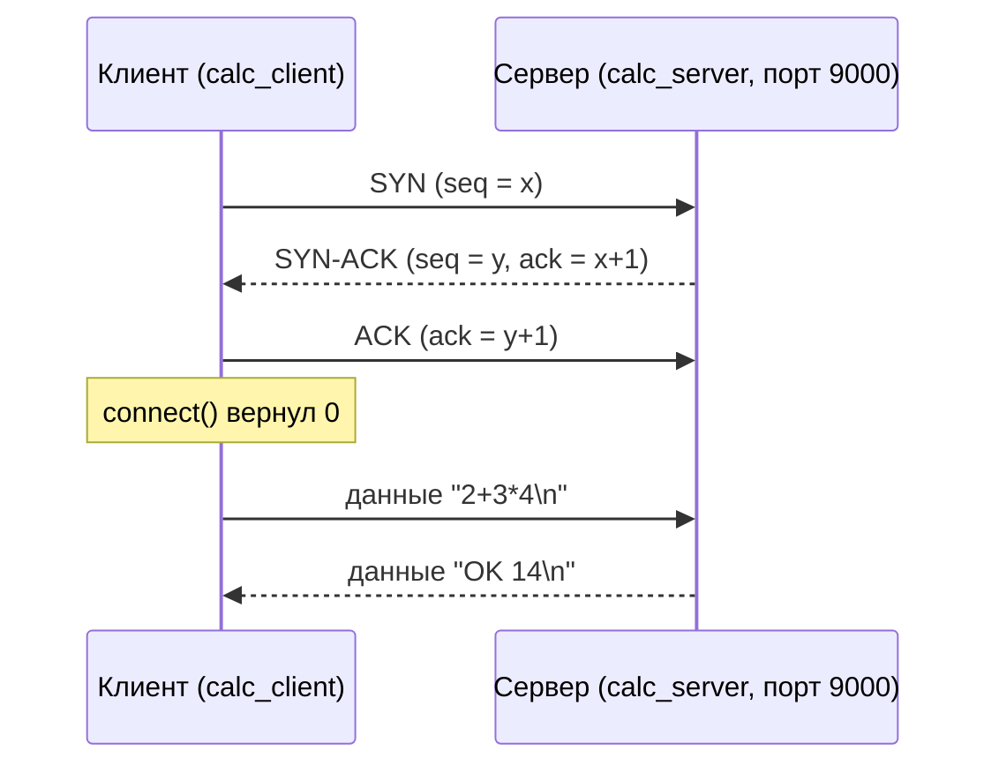

# network_programming_only_dz

# hw02 (13.11)

# hw03 (13.11)

Подключаем сервер и клиент:

Программа не падает, если сервер отключён, а выводит ожидаемую ошибку:

Схема:

# hw04 (17.11)

Запуск сервера и трёх клиентов + проверка эхо и подключения/отключения:

(Эссе представлено в папке hw04)

hw03 (17.11)

запуск select_server и wepoll:

клиент получает эхо:

Таблица:

| Механизм | Сложность | Предел дескрипторов | Где доступно | Когда выбирать |
|---|---|---|---|---|
| select | O(n) | FD_SETSIZE (в Windows 64) | Везде (Windows / Linux / macOS) | Простые задачи, до 60-100 соединений. |
| poll | O(n) | Без жёсткого лимита (ограничено памятью) | POSIX (Linux / macOS) | Переносимый код без лимита select, если производительность не критична. |
| epoll | O(готовых) | Память ядра (тысячи и миллионы) | Linux (на Windows через wepoll) | Высоконагруженные серверы с тысячами соединений. |
| kqueue | O(готовых) | Память ядра (тысячи и миллионы) | BSD, macOS | Аналог epoll для систем BSD/macOS. |
